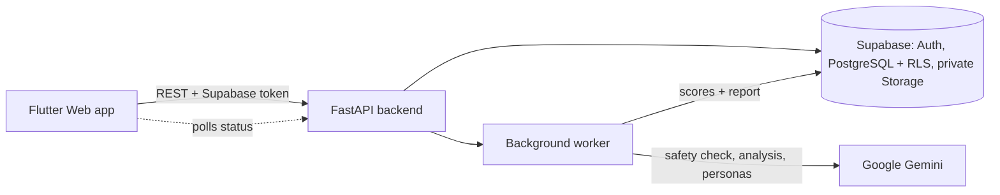

<div align="center">

# 🎬 ViralForge

### Know how your short video will land, before you post it.

AI-powered, **video-first** readiness analysis for Instagram Reels, TikTok and YouTube Shorts.

`Flutter Web` · `FastAPI` · `Supabase` · `Google Gemini`

</div>

---

## What it does

Upload a short clip, say where you will post it, and ViralForge watches the **actual video** and returns a
**Viral Readiness Report**:

| You get | Details |
|---|---|
| **5 scores** | Hook, Engagement, Retention, Shareability and an Overall score with a verdict |
| **7 rated dimensions** | Each with a short explanation |
| **Strengths and weaknesses** | What works and what holds the video back |
| **Prioritised fixes** | Ordered by expected impact, with timestamps that jump the built-in player to the moment |
| **10 simulated viewers** | Ten fixed AI personas react to the video, clearly labelled as simulations |
| **Share and download** | Copy a summary, share it, download an HTML or text report, or print to PDF |

> **Scores are computed by backend code, never by the AI.** The AI only rates the seven dimensions from 1 to 10;
> the five scores are derived with fixed formulas, so results are reproducible and a prompt injection cannot set them.

### Who it is for
Creators, small businesses, social media managers and students who want objective feedback before they post.

---

## How it works



The analysis runs as a background job with live progress:

| Step | What happens | Progress |
|---|---|---|
| 1. Validate | File type read from the bytes, size and duration limits, stored in a private bucket | 5 % |
| 2. Upload to Gemini | The clip is sent to the Gemini Files API | 25 % |
| 3. Safety check | Moderation runs first and **fails closed**: if it cannot finish, nothing is analysed | 35 % |
| 4. Analysis | Gemini rates the 7 dimensions | 50 % |
| 5. Personas | 10 viewer reactions (retried in smaller batches if needed; never fails the report) | 80 % |
| 6. Scoring | Backend computes the 5 scores and builds the report | 100 % |

---

## Tech stack

| Part | Technology |
|---|---|
| Frontend | Flutter Web (Dart), Riverpod, go_router, Dio |
| Backend | Python 3.11+, FastAPI, Pydantic v2 |
| Auth, database, storage | Supabase (email and password auth, PostgreSQL with row level security, private bucket) |
| AI | Google Gemini through the official `google-genai` SDK (model chosen in `.env`) |
| Tests | pytest, ruff, flutter analyze, flutter test (Gemini is mocked, so no API credits are used) |

## Project layout

```
viralforge1.0/
├── backend/            FastAPI app (routers, services, worker, tests)
│   └── app/services/   gemini.py · pipeline.py · personas.py · scoring.py · safety.py · worker.py
├── frontend/           Flutter Web app (screens, widgets, state, tests)
├── supabase/setup.sql  Database schema, row level security, storage bucket
├── scripts/            setup, run, test and diagnostic scripts
└── docs/               API.md · SCORING.md · VERIFICATION.md
```

---

## Quick start (Windows)

### Prerequisites
1. **Python 3.11 or newer**: https://www.python.org/downloads/ (tick *Add python.exe to PATH*)
2. **Flutter SDK** (stable, with web support): https://docs.flutter.dev/get-started/install/windows/web
3. **Google Chrome**
4. A **Supabase** account (free plan is fine) and a **Gemini API key**

### 1. One-time cloud setup

**Supabase**
1. Open https://supabase.com/dashboard → **New project**. Wait until it finishes provisioning.
2. **Project Settings → API**. Keep this page open; you need three values: **Project URL**, the public key
   (**anon** or **publishable**) and the secret key (**service_role** or **secret**).
3. **SQL Editor → New query**. Paste the whole of `supabase\setup.sql` and press **Run**
   (*Success. No rows returned*). It is safe to run again.
4. **Authentication → Sign In / Providers → Email**. For quick local testing you may switch **Confirm email** off.
5. **Authentication → URL Configuration** → set **Site URL** to `http://localhost:5173`.
6. **Storage**: confirm a bucket named **videos** exists and is **Private**.

**Gemini**
1. Open https://aistudio.google.com/apikey → **Create API key**.

### 2. Configure and install

```powershell
powershell -ExecutionPolicy Bypass -File .\scripts\setup.ps1   # first run creates .env
notepad .env                                                    # replace every YOUR_... placeholder
powershell -ExecutionPolicy Bypass -File .\scripts\setup.ps1   # installs everything, ends with "Setup complete"
```

> 🔒 Keys live only in your private `.env`. Never paste them into chat or commit them.

### 3. Run (two terminals)

```powershell
.\scripts\run-backend.ps1      # Terminal 1: API on http://localhost:8000
.\scripts\run-frontend.ps1     # Terminal 2: opens Chrome on http://localhost:5173
```

| URL | What it is |
|---|---|
| http://localhost:5173 | The app |
| http://localhost:8000/docs | Interactive API documentation (Swagger) |
| http://localhost:8000/api/v1/health | Liveness |
| http://localhost:8000/api/v1/health/ready | **Readiness**: config, database tables, and that your Gemini key can use `GEMINI_MODEL` |

**Open `/health/ready` before testing.** If it says `degraded`, its `checks` section tells you what to fix. If
`gemini_model.ok = false`, set `GEMINI_MODEL` in `.env` to a model your key can use and restart the backend.
The app never silently switches models.

### 4. Use it
Register → create a project → **New analysis** → drop or choose a video (MP4, WebM or MOV, up to 90 s and 50 MB by
default) → pick platform, niche and audience → **Upload and analyse**. The status page updates live and you can leave
it; finished reports live under the project and in **History**.

---

## Configuration

Set in `.env` (the file explains every value). Restart the backend after changing it.

| Variable | Purpose |
|---|---|
| `GEMINI_API_KEY` | Your Gemini key. Read only at start-up, so restart after changing it |
| `GEMINI_MODEL` | The Gemini model to use. Must be available to your key |
| `PARALLEL_MODERATION` | Optional. `false` (default) runs the safety check first, then the analysis. `true` runs both at once |
| `MAX_UPLOAD_MB` | Upload size cap (default 50) |
| `SUPABASE_URL`, `SUPABASE_ANON_KEY`, `SUPABASE_SERVICE_ROLE_KEY` | Your Supabase project |

## Tests and diagnostics

```powershell
.\scripts\test.ps1          # ruff, pytest, flutter analyze, flutter test
```
If PowerShell blocks the script, run `Set-ExecutionPolicy -Scope Process -ExecutionPolicy Bypass` first.

Check the AI on its own, with no website and no Supabase (uses a little of your Gemini quota):
```powershell
backend\.venv\Scripts\python.exe scripts\check_ai.py                  # model, safety check, analysis, personas
backend\.venv\Scripts\python.exe scripts\check_ai.py "C:\path\clip.mp4"   # also tests the video upload
```
Every step prints `[ OK ]` or `[FAIL]` with the real reason. Other helpers: `check_config.py`, `check_gemini.py`,
`check_models.py`.

## Troubleshooting

| Symptom | Fix |
|---|---|
| `Missing configuration: ...` when starting the backend | `.env` still has placeholders. Edit it and restart |
| Sign-in screen cannot reach the service | Check `SUPABASE_URL` / `SUPABASE_ANON_KEY`, then re-run `run-frontend.ps1` |
| "Cannot reach the ViralForge server" | Backend is not running, or `API_BASE_URL` / `CORS_ORIGINS` in `.env` do not match the ports in use |
| Analysis fails with "AI service is busy or unreachable" | The message now includes the real cause (for example `503 UNAVAILABLE`). Run `scripts\check_ai.py`, check your key and `GEMINI_MODEL`, then press **Retry** |
| Analysis fails with `ai_declined` | Gemini's own safety filter blocked this video. Try a different clip |
| `/health/ready`: `database.ok = false` | `supabase\setup.sql` was not run, or the Supabase URL or service key is wrong |
| Upload says "Could not read the video's duration" | The file is damaged. Re-export as a standard MP4 (H.264) |
| Upload fails above 50 MB | Supabase's free plan caps single files at 50 MB |
| Registered but cannot sign in | Email confirmation is on: click the emailed link, or turn **Confirm email** off |

---

## Security

- The Supabase **service-role key** and the **Gemini key** exist only in the backend process. `frontend\config.json`
  holds only public values and is git-ignored.
- Every query is filtered by the signed-in user; other users' resources return `404`. Row level security on all tables
  is a second layer. Videos are private and reachable only through short-lived signed URLs.
- Captions, scripts, niche text and anything inside the video are treated as untrusted data: sanitised, wrapped in
  per-request random delimiters, and the model is told never to follow instructions found there.
- Moderation runs before analysis and **fails closed**. Blocked submissions are deleted and only the error code is kept.
- Per-user rate limits apply (defaults: 120 requests/min, 20 uploads/hour, 20 analyses/hour).
- Sharing a report never creates a public link: the summary and downloads are built in your browser from the report
  you already have open.

## Known limits

- The worker and rate limiter run in one process: right for local use, not for several server instances.
- Uploads pass through the backend and are held in memory (up to `MAX_UPLOAD_MB`).
- Scores and personas are AI opinions, not predictions or audience research. The report says so.

## Documentation

- [docs/API.md](docs/API.md): API contract
- [docs/SCORING.md](docs/SCORING.md): rubric, formulas, moderation and safety
- [docs/VERIFICATION.md](docs/VERIFICATION.md): what was verified and how

---

<div align="center">
Built as a field project. Standalone: it shares nothing with any other ViralForge repository.
</div>
